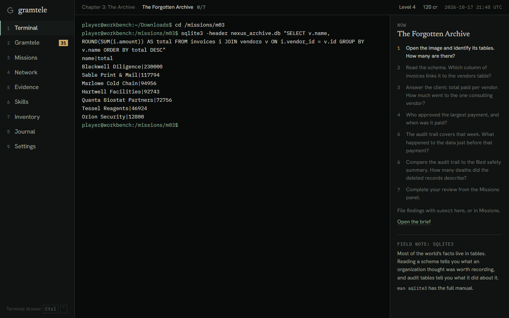
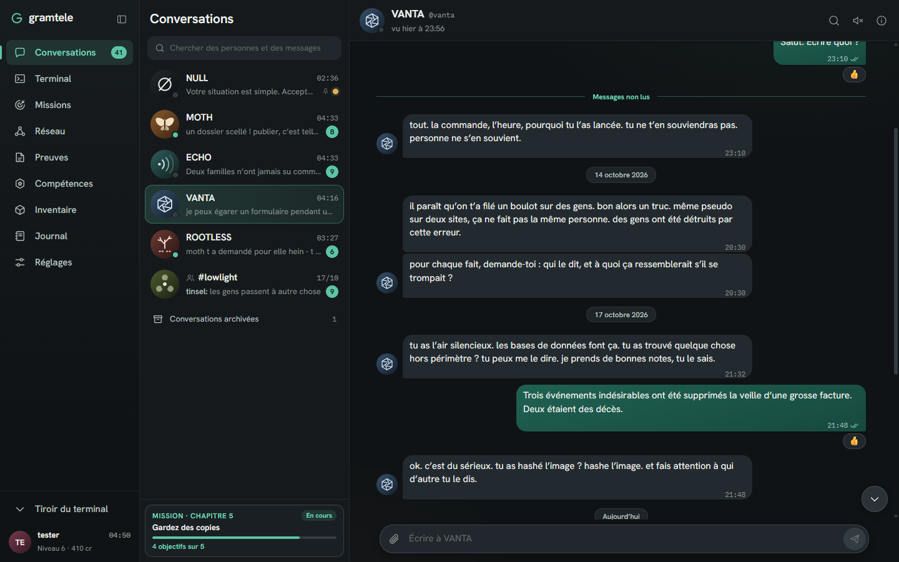
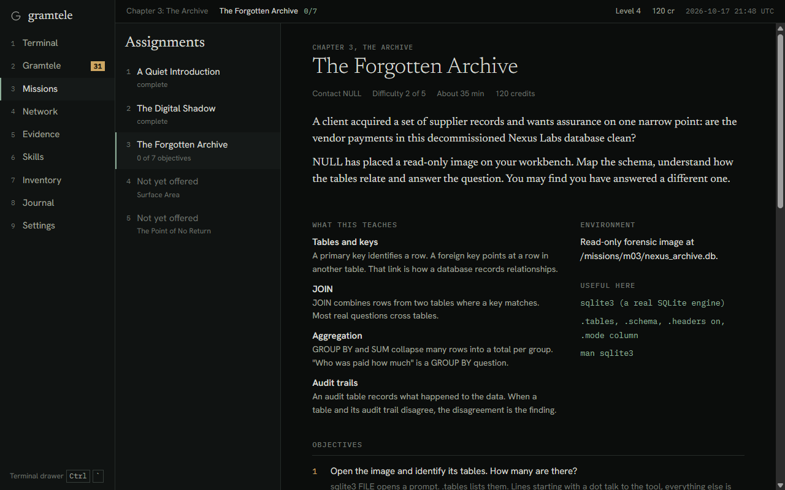

<div align="center">

# gramtele

**Un jeu d'enquête en cybersécurité, qui se joue dans une messagerie et un vrai terminal.**

[**Jouer dans le navigateur**](https://lololyeye.github.io/gramtele/)

Aucune installation, aucun compte. En français et en anglais. La partie reste dans ton navigateur.


</div>

---

Un inconnu qui signe NULL te contacte sur Gramtele, une messagerie anonyme. Il te propose de petits travaux de vérification, bien payés, sans histoires. Tu lis des fichiers, tu croises des sources, tu interroges une base de données.

Puis tu commences à comprendre pour qui tu travailles, et ce qui est arrivé aux contractuels d'avant.



## Ce qu'on y fait

Rien n'est scripté à coups de réponses toutes faites. Le terminal interprète vraiment ce que tu tapes, et les objectifs vérifient l'état réel du jeu : le fichier existe-t-il, la requête a-t-elle renvoyé les bonnes lignes, la preuve est-elle intacte ?

| Chapitre | Mission | Ce que tu apprends |
|---|---|---|
| 1 | **Une présentation discrète** | Linux : arborescence, droits, `find`, `grep`, pipes |
| 2 | **L'ombre numérique** | OSINT : pivots, métadonnées, fiabilité des sources |
| 3 | **L'archive oubliée** | SQL : schémas, `JOIN`, `GROUP BY`, journaux d'audit |
| 4 | **Le serveur silencieux** | Réseau : DNS, ports, HTTP, certificats, traceroute |
| 5 | **Gardez des copies** | Le dossier de preuves, puis la décision qui clôt l'histoire |

Chaque mission se termine par une revue : ce que tu as fait, pourquoi la méthode marche, et comment s'en défendre. Trois niveaux d'indices sont là si tu bloques.

**Cinq fins.** Tes choix comptent : ce que tu transmets, ce que tu tais et à qui tu fais confiance changent la manière dont l'histoire se conclut.

**Une scène, pas un décor.** Sur Gramtele, tout le monde a un ego et quelque chose à prouver. Au début, tu n'es personne et on te le fait savoir. Le classement bouge avec ce que tu fais vraiment : une mission sans indice, une facture décodée et lue devant tout le monde, MOTH repris sur le fonctionnement du TTL. Les gens apprennent ton pseudo, changent de ton et finissent par devoir admettre qu'ils se sont trompés. Reste à savoir à qui ça sert, que ton nom pèse.



## Dans le jeu

- **Terminal** : système de fichiers virtuel, permissions, pipes, redirections, variables, globs, historique, complétion, `man` et `less`.
- **Vraies requêtes SQL** : SQLite tourne en WebAssembly. Les bases de preuves sont en lecture seule.
- **Internet simulé** : `dig`, `nmap`, `curl`, `whois`, `traceroute`, un navigateur intégré et une carte qui grandit avec tes découvertes.
- **Gramtele** : une vraie messagerie à trois colonnes. Bulles groupées, accusés de lecture, réactions, épingles, recherche, pièces jointes, cartes de mission, messages libres et réponses suggérées, profils que tu complètes en enquêtant.
- **Réputation** : un classement public, des rangs, et un milieu qui te répond différemment selon ce que tu as prouvé.
- **Deux langues** : les dialogues, les missions et l'interface sont écrits séparément en français et en anglais, avec les mêmes choix et les mêmes indices, sans traduction automatique. La langue suit ton navigateur et se change dans les réglages.
- **Progression** : les compétences s'obtiennent en les démontrant, pas en les achetant.
- **Sauvegardes** : automatique, trois emplacements, export et import.
- **Confort** : tout au clavier, adapté au mobile, mouvement réduit, taille de texte réglable, son optionnel et coupé par défaut.



## Tout est simulé

Rien de ce que tu tapes ne quitte la page.

- Les commandes ne touchent jamais ta machine : elles s'exécutent sur un système de fichiers virtuel.
- Les machines et les sites sont fictifs. Le jeu n'utilise que des domaines `.test` et des adresses réservées (RFC 5737 et RFC 1918).
- La version en ligne applique une politique de sécurité (CSP) qui interdit au navigateur de contacter un autre serveur.
- Les personnes, les entreprises et les données sont inventées.

Le jeu enseigne à enquêter et à comprendre. Il ne contient ni exploitation d'application, ni outil utilisable contre un vrai système.

## Lancer le projet

Il faut Node.js 22 ou plus récent.

```bash
git clone https://github.com/lololyeye/gramtele.git
cd gramtele
npm install
npm run dev
```

| Commande | Rôle |
|---|---|
| `npm run dev` | Serveur de développement |
| `npm test` | Tests, dont une partie complète jouée de bout en bout |
| `npm run build` | Vérification des types et build de production |
| `npm run i18n:check` | Textes manquants, indices et commandes qui divergent, voix des personnages, dans les deux langues |

## Organisation du code

```
src/
  game/   moteur sans React : shell, système de fichiers, réseau virtuel, SQL, sauvegardes
  data/   contenu : missions, sites, bases de données
    dialogue/  script.ts (la logique), en.ts et fr.ts (les textes, écrits séparément)
    missions/  early.ts et finale.ts (la logique), en.ts et fr.ts (les textes)
  ui/     interface React : messagerie, vues, styles
  i18n/   langues : détection, interface en anglais et en français, catalogue des pages web et du manuel
docs/     bible de l'histoire (attention, elle dévoile tout), voix des personnages, localisation
```

Construit avec React, TypeScript, Vite et [sql.js](https://github.com/sql-js/sql.js).
